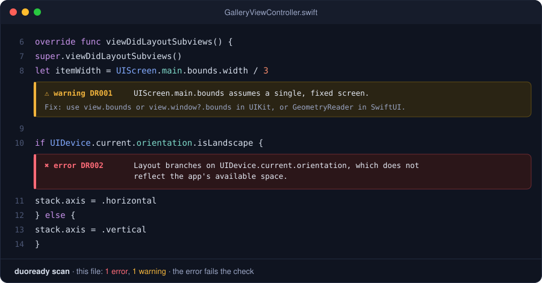

<div align="center">

# DuoReady

**Catch iOS layout bugs before your users do.**

DuoReady scans your SwiftUI and UIKit code for layouts that break when an app's window
changes size, and tells you exactly how to fix them.


[Quick start](#-quick-start) · [Rules](RULES.md) · [GitHub Action](#-add-it-to-your-pull-requests) · [Contributing](CONTRIBUTING.md)

<br>



</div>

<br>

## Why DuoReady?

A lot of iOS code quietly assumes the app fills one fixed screen:

```swift
let width = UIScreen.main.bounds.width          // "the screen is my window"
if UIDevice.current.orientation.isLandscape {…} // "landscape means wide"
if UIDevice.current.userInterfaceIdiom == .pad {…} // "iPad means big"
```

That held when every iPhone app ran full screen. It doesn't anymore. Windows get resized, split
and shared, and devices like iPhone Duo change shape. Code like this clips, overflows or picks
the wrong layout, and you usually don't find out until a user sends a screenshot.

<!-- TODO before release: confirm Apple's official name and supported configurations for the
     target device, and update the device reference above to match. -->

**DuoReady finds these assumptions for you, explains why each one is risky, and shows the
adaptive fix.**

<table>
<tr>
<td width="33%" valign="top">

### 🔒 Private by design

Runs entirely on your Mac or CI runner. No uploads, no account, no telemetry, no network calls.

</td>
<td width="33%" valign="top">

### 🧩 Zero app changes

Reads your source code only. Nothing to add to your app, and it never builds or runs your
project.

</td>
<td width="33%" valign="top">

### ✅ Built for teams

Shows findings inline on pull requests, and a baseline lets large apps adopt it without
fixing everything first.

</td>
</tr>
</table>

## 🚀 Quick start

You need a Mac with Swift 6.0 or later, which comes with Xcode.

**1. Install**

With [Homebrew](https://brew.sh) (available from v0.1.0):

```sh
brew install toluwade/tap/duoready
```

Or with [Mint](https://github.com/yonaskolb/Mint):

```sh
mint install toluwade/duoready
```

<details>
<summary>Other ways to install</summary>

<br>

**Pin a version for your whole team with Mint.** Add this line to a `Mintfile` in your app's
repository:

```
toluwade/duoready@v0.1.0
```

Everyone then runs the same version with `mint run duoready scan .`

**Build from source:**

```sh
git clone https://github.com/toluwade/duoready.git
cd duoready
swift build -c release
sudo cp .build/release/duoready /usr/local/bin/
```

The first build takes a few minutes, because it compiles Apple's Swift parser.

</details>

**2. Scan your app**

```sh
duoready scan path/to/YourApp
```

**3. Read the results**

```
Views/GalleryViewController.swift:8:25: warning: [DR001] UIScreen.main.bounds assumes a single, fixed screen.
    Fix: Use the size of the containing view or window (view.bounds, view.window?.bounds) in UIKit, or GeometryReader / containerRelativeFrame in SwiftUI.

Scanned 42 files: 1 warning.
```

Every finding shows the file and line, a rule ID you can look up, and a fix that fits the code it
found. Add `--explain` to see why each pattern is risky.

## 🔍 What it catches

| Rule | Catches | Instead, use |
| :-- | :-- | :-- |
| [**DR001**](RULES.md#dr001) | `UIScreen.main` for sizes or scale | The view's or window's own bounds, `traitCollection.displayScale` |
| [**DR002**](RULES.md#dr002) | Choosing a layout from device orientation | Size classes, the container's size, `ViewThatFits` |
| [**DR003**](RULES.md#dr003) | Choosing sizes from iPhone vs iPad | Size classes, the container's size |
| [**DR004**](RULES.md#dr004) | Detecting devices by screen size, like `height == 812` | Safe-area insets, size-based breakpoints |
| [**DR005**](RULES.md#dr005) | Auto Layout constraints fixed to screen-sized values | Constraints relative to the container, maximum widths |
| [**DR006**](RULES.md#dr006) | SwiftUI `.frame(width:)` the size of a whole screen | `maxWidth`, `containerRelativeFrame` |

DuoReady aims for findings you can trust over catching everything. Each rule skips the legitimate
lookalikes: camera code that really needs orientation, conditions that already check size
classes, fixed frames in previews, small icon sizes, test code and macOS-only code. See
[RULES.md](RULES.md) for the details and known limitations.

## 🤖 Add it to your pull requests

Add this workflow as `.github/workflows/duoready.yml`. Findings then appear as annotations on
the changed lines of every pull request.

```yaml
name: DuoReady
on: [pull_request]
permissions:
  contents: read
jobs:
  scan:
    runs-on: macos-latest
    steps:
      - uses: actions/checkout@v4
      - uses: toluwade/duoready@v0.1.0
        with:
          severity: error   # fail the check on errors; warnings are shown but don't fail it
```

<details>
<summary>Action inputs</summary>

<br>

| Input | Default | Purpose |
| --- | --- | --- |
| `path` | `.` | Directory or file to scan |
| `config` | | Configuration file |
| `severity` | config `failOn` | Fail at or above this severity: `info`, `warning` or `error` |
| `format` | `github` | `github`, `text` or `json` |
| `upload-report` | `false` | Upload a JSON report as a workflow artifact |

For a release tag such as `@v0.1.0`, the action downloads that version's prebuilt binary and
verifies its checksum, so it starts in seconds. For any other ref, it builds DuoReady once
(a few minutes) and caches the result for later runs. It needs only `contents: read`, and it
never builds or runs the code it scans.

</details>

## 📦 Using it on an existing app

Got 80 findings on day one? You don't have to fix them all before turning on CI. Record them in
a **baseline**:

```sh
duoready baseline .
git add .duoready-baseline.json
```

From then on, scans report and fail only on **new** findings. Fix the old ones at your own pace,
then run `duoready baseline` again to shrink the file.

<details>
<summary>How baseline matching works</summary>

<br>

- Matching uses each finding's rule, file and line text, not its line number, so adding code
  elsewhere in a file doesn't break it.
- Editing the flagged line or renaming the file makes the finding new again.
- When you fix a baselined finding, DuoReady says so and tells you to regenerate the file.
- Each baseline entry hides one finding, so a copy of an old problem on a new line is still
  reported.
- Create and use the baseline with the same scan `path`.
- `duoready scan --no-baseline` shows everything.

</details>

## ⚙️ Configuration

Configuration is optional. To customize DuoReady, create `.duoready.json` in your project:

```sh
duoready config init
```

```json
{
  "version": 1,
  "exclude": ["Pods/**", "Vendor/**"],
  "rules": {
    "DR002": { "severity": "error" },
    "DR006": { "enabled": false }
  },
  "failOn": "error"
}
```

To silence a single line that's intentional:

```swift
let scale = UIScreen.main.scale // duoready:ignore DR001
```

<details>
<summary>All configuration options</summary>

<br>

| Key | Meaning |
| --- | --- |
| `exclude` | Globs relative to the scanned folder. `**` matches any depth. `.build`, `.git`, `DerivedData`, `Pods`, `Carthage`, `build` and `node_modules` are always skipped. |
| `rules` | Enable or disable a rule, or change its severity. Unknown rule IDs are an error, so typos don't fail silently. |
| `failOn` | The lowest severity that fails a scan. `--severity` overrides it. |
| `baseline` | Path to the baseline file, relative to this file. Default: `.duoready-baseline.json`. |
| `includeTests` | Also scan test code. Default: `false`, because tests often fix sizes on purpose. |

A `// duoready:ignore` comment on its own line applies to the next line. With no rule IDs, it
silences every rule.

</details>

<details>
<summary>All commands</summary>

<br>

| Command | Purpose |
| --- | --- |
| `duoready scan [path]` | Scan a folder or `.swift` file (default `.`) |
| `duoready scan --format json` | Output as `text`, `json` or `github` annotations |
| `duoready scan --severity warning` | Fail on findings at or above a severity |
| `duoready scan --output report.json` | Write the report to a file |
| `duoready scan --explain` | Include the reason behind each finding |
| `duoready scan --no-baseline` | Show every finding, ignoring the baseline |
| `duoready scan --include-tests` | Also scan test targets and test files |
| `duoready baseline [path]` | Record current findings so scans report only new ones |
| `duoready rules [ID]` | List the rules, or explain one |
| `duoready config init` | Create a starter `.duoready.json` |
| `duoready config validate` | Check a configuration file |
| `duoready version` | Print the version |

**Exit codes:** `0` passed · `1` findings crossed the threshold · `2` invalid arguments or
configuration · `3` the scan itself failed. CI can tell "your code has issues" apart from "the
scanner broke."

</details>

## 🛠️ How it works

DuoReady parses each Swift file with Apple's [SwiftSyntax](https://github.com/swiftlang/swift-syntax),
the same parser the Swift compiler uses. It reads real code structure, not text patterns, so it
can tell `UIScreen.main` in code from the same words in a comment or string. Each rule is a small,
independently tested check, which makes adding a new one easy.

**DuoReady is not:**

- **A guarantee.** It finds common, recognizable risks. Keep testing at different window sizes.
- **An auto-fixer.** The right fix depends on context, so it explains the fix instead of
  rewriting your code.

## 🤝 Contributing

Contributions are welcome. The most valuable one is a **false-positive report**: if DuoReady
flags code that's actually fine, [open an issue](../../issues/new/choose) with a small snippet.

Want to write a rule? [CONTRIBUTING.md](CONTRIBUTING.md) walks through it, from proposal to tests
and docs.

```sh
swift build && swift test
```

## License

[MIT](LICENSE). Free for personal and commercial use.
